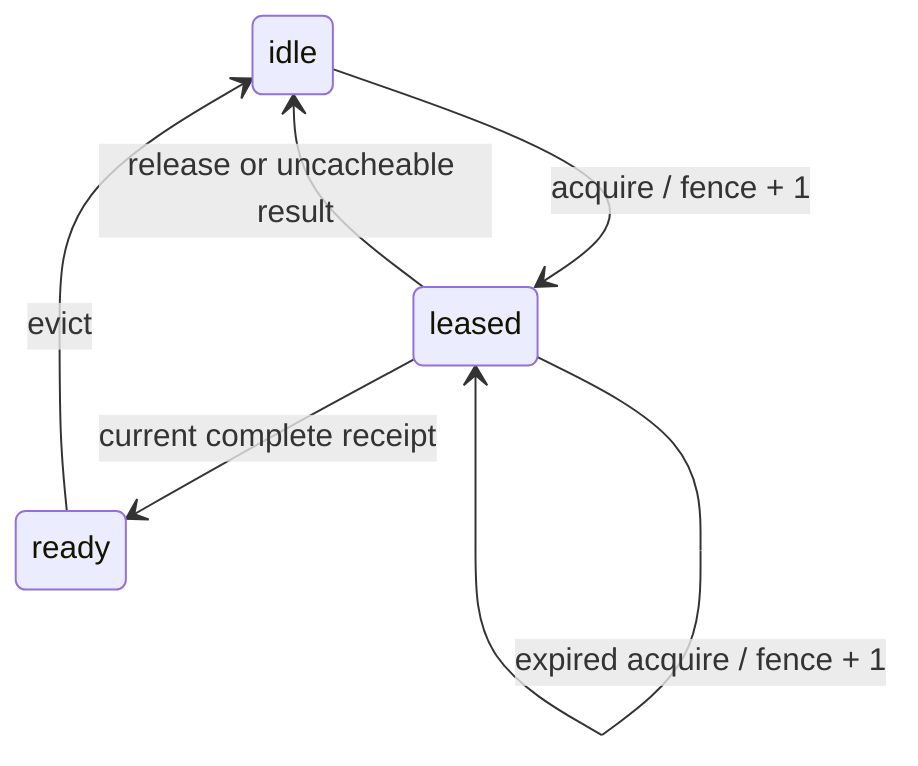

# 完了した検査を共有する

`@mizchi/idealis/check-cache` は、同じ入力に対する完全探索の結果をtask単位で再利用する。ブラウザでも使えるTSコア、HTTP client、NodeのSQLite storeを分けている。Leanは開発時の証明に使い、利用時には不要。

最初の対象は、非空の初期状態から探索を完了した`explicit-complete`。`bounded`相当の未確定結果、`empty`、評価エラー、反例は実行結果として返すが、成功キャッシュには保存しない。時間論理を含め、backendが完全探索と判定した内容を保存する。キャッシュ自体がbackendの意味論を証明するわけではない。

## 同一性と所有権

identityは、`buildDigest`、backend descriptor、`BackendRequest`全体をcanonical JSONにしたもの。入力IR、scope、property、assumptions、探索上限も含む。SHA-256を検索keyに使い、取得後はidentity全文とartifactのdigest、結果のbackend/scope/queryを検査する。

呼び出し側は`buildDigest`に実際のエンジンと、その意味に影響する依存を網羅したdigestを渡す。評価例では実際のWasm bytesのSHA-256を使う。外部関数や環境に依存するbackendでは、その依存も固定する必要がある。バージョン文字列だけでは同一実装を保証できない。JSONで符号を保持できない`-0`はlease取得前に拒否する。`+0`は使える。



storeはkeyごとにlinearizableなCASを提供する。`revision`は更新ごと、`fence`は新しい取得ごとに増える。renewはfenceを変えない。publishは現在のowner/fence、渡された時刻、receiptのidentityに加え、実行時のowner/fence/runIdを確認する。別leaseのreceiptは公開できない。解放・evictionでも行を消さず、世代を保持する。digestが壊れたartifactもevictでき、再取得時は世代が進む。行を削除して同じkeyを初期化するとABA防止の前提が崩れる。

時刻は呼び出し側が渡す非負のsafe integer。期限切れは`now >= expiresAt`。ホスト間で同じ時間基準を使い、必要なら明示的にrenewする。自動heartbeatやretry、実時間での終了保証は提供しない。通信切断やCAS失敗時は再読取りし、store障害は例外として返す。HTTP handlerの認証・配置はホスト側が担当する。

## 実行と計画

```ts
import { createCheckCache, runCachedCheck } from "@mizchi/idealis/check-cache";
import { createHttpCheckCacheStore } from "@mizchi/idealis/check-cache/http";

const cache = createCheckCache(createHttpCheckCacheStore(endpoint));
const result = await runCachedCheck(cache, job, backend, {
  owner: workerId,
  runId,
  now: Date.now,
  leaseMs: 60_000,
});
```

`job`は`CheckCacheJob`、`backend`は既存の`VerificationBackend`。結果は`executed`、`cached`、他workerが所有中の`deferred`に分かれる。`executed.publication`が`stale`でも実行した結果は残る。期限を過ぎた計算を共有storeの成功として公開しない。publishが所有権を解放した後はreleaseしない。staleの後のreleaseが失敗した場合は`executed.cleanupError`へ返す。実行例外とrelease例外が重なった場合は、元の例外を`cause`と`errors[0]`に持つ`AggregateError`を投げる。

Nodeでは`createSqliteCheckCacheStore(path)`、同一process内では`createMemoryCheckCacheStore()`を使える。SQLiteはWALとrevision条件付き更新を使い、別connection・別processから共有できる。`createCheckCacheHttpHandler(store)`で同じCAS契約をHTTPへ公開する。SQLite adapterだけがNode APIに依存する。

Node adapterはNode.js 24+を使う。TSでは`@types/node`と`types: ["node"]`も設定する。ブラウザ用の2つのentryはNodeの型やAPIを参照しない。

`planCachedChecks(cache, jobs, profiles, budget, options, now)`は、hitを`cached`、所有中を`deferred`へ分け、missだけを既存plannerへ渡す。検索・検証に使った時間も残り時間から引く。配布直前にも`runCachedCheck`で取得し、計画後の競合に対応する。`deferred`は完了扱いにせず、後で呼び出し側が再計画する。

新しいmanifestのtask ID/sourceVersionはそのまま使い、再利用元のrun ID、key、artifact digestを`origin`へ残す。保存結果の`progress.work`は元の探索の仕事量で、今回の探索量へ加算しない。全hitでplanが`empty`になることと、モデルの初期状態が`empty`であることは別の結果。

## 証明する範囲

[`formal/cache/Cache.lean`](../formal/cache/Cache.lean)は、自然数に上限を置かず、状態遷移を定義する。task cacheの17定理には、identity不変、fence単調増加、古いfence・別owner・期限切れ・異なるreceipt・未完了結果の公開拒否、renew時の世代維持、任意長のtraceにわたる不変条件、正常なhitへの到達例がある。状態別Next再利用の9定理を加え、有効化フラグの1定理と合わせ、現在は合計27定理を監査する。

初期状態を包含し、現在のNextに対して閉じた集合を再検査すれば、そのpropertyが全到達状態で成立する定理も置いた。[同一Nextの状態別cache](safety-expansions.md)では、現在のInitから再探索し、propertyを再検査する。Nextの変更をまたぐ部分共有、既存visited setの流用とTLC checkpointの再開は未実装。この定理だけで既存visited setを再利用してよいとは判定できない。

Lean 4.35.0 / Stdを固定し、`sorry`・追加axiom・`native_decide`を禁止する。全定理のaxiom一覧を検査し、`leanchecker`で再検査する。標準の`propext`、`Classical.choice`、`Quot.sound`は利用する。graphの2定理にaxiom依存はない。

TS全体の機械証明ではない。純粋なTS policyとLeanの実行可能な参照機を有限領域で全比較し、そのpolicyをCAS coordinatorに使う。CASのlinearizability、依存identityの網羅、backendの正しい完全探索判定は前提。TSはsafe integerを検査し、Leanの無制限自然数との境界を拒否する。

```sh
just cache-proof .artifacts/new-cache-proof
just cache-test
just browser
just cache-tlc /path/to/java /path/to/tla2tools.jar .artifacts/new-cache-tlc
just cache-eval .artifacts/new-cache-eval
just cache-replay .artifacts/new-cache-eval .artifacts/new-cache-replay
```

TLC用にはJSON trace出力を含む`tlaplus` jarを指定する。2 worker・2取得世代・clock 0..3の有限モデルを探索し、3つの人工故障と正常なpublishへの到達を対照にする。clockや世代の上限による終端はdeadlockとして扱わず、livenessは検査しない。評価条件は[計画](../evals/plans/verified-cache.md)、結果は[評価記録](../evals/iterations/verified-cache.md)に残す。

## 通常 CI での再利用

GitHub Actions の差分テストでは、Quint 生成モデル、記号演算子、Rust safety、collections/temporal、TLC 回帰コーパスの検査結果をモデル単位で保存する。CI で使う検査器は `rtlc` の native / Wasm と参照用の `tla-ts`。それぞれの非空の完了結果を別々に保存し、ヒット時も状態数やオラクルとの照合を実行する。反例・予算切れ・エラーと、時間やメモリを測るテストは毎回実行する。

Actions のキーには両検査器のバージョン、実行バイナリと Wasm、ホストの JS、依存ロック、OS・CPU アーキテクチャ・Node のバージョンを含める。コーパスを変更した場合は同じ検査器ビルドのスナップショットを復元し、検査要求全体が一致するエントリを再利用する。設定、モジュール、探索上限などを変えた入力は再検査する。各テストプロセスのログには検査器別のヒット数と保存数が出る。

ローカルでは既定で無効。ビルド済みの作業ツリーで `IDEALIS_TLC_RESULTS=.artifacts/tlc-results just rtla-symbols-test` を同じ条件で 2 回実行すると、初回の保存と次回の再利用を確認できる。
