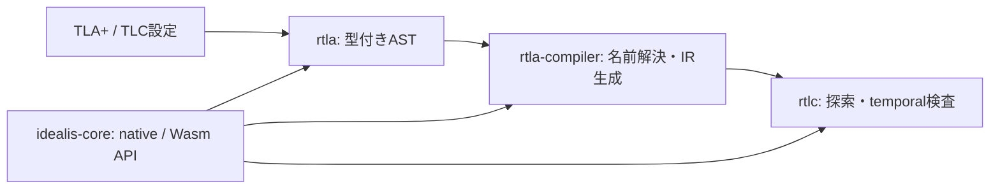

# RustだけでTLA+ソースを検査する

`compileTlaSource`と`checkTlaSource`は、idealis-coreのWasmでTLA+ソースを解析・変換・検査する。ブラウザとNodeで使え、tla-ts、Z3、JVMを必要としない。Rust nativeでは同じfrontendをlibraryとJSONLで使える。

```ts
import {
  createPortableWasm,
  compileTlaSource,
  checkTlaSource,
} from "@mizchi/idealis/portable";

const core = await createPortableWasm(wasmBytes);
const input = {
  source:
    "---- MODULE Counter ----\nEXTENDS Naturals\nVARIABLE x\nInit == x = 0\nNext == x' = x + 1\nSafe == x < 3\n====",
  config: "INIT Init\nNEXT Next\nINVARIANT Safe",
};
const program = compileTlaSource(core, input);
const result = checkTlaSource(core, input, {
  maxDepth: 10,
  maxStates: 100,
  maxWork: 10_000,
});
```

`program`は保存・再利用できるSafetyProgram。既存の`checkSafety`、nativeの並列API、`createRtlcBackend`にも渡せる。直接検査する場合は`checkTlaSource`を使う。ソースの構文・未対応fragment・評価のエラーはPortableCoreErrorとなり、空集合や予算切れへ変換しない。

## crateの境界



rtlaはparser、rtlcはIRとcheckerとして独立している。rtla-compilerが両方へ依存し、`compile(&Module, &Config)`でSafetyProgramを返す。idealis-coreの`compile_tla(source, config)`は解析と変換をまとめる。

```sh
cargo run --locked --manifest-path crates/rtla-compiler/Cargo.toml --example check
```

native JSONLでは`{"version":1,"request":{"kind":"compile-tla","source":"…","config":"…"}}`が`{"kind":"compiled","program":…}`を返す。`check-tla`は同じsource/configとboundsを受け、既存の`{"kind":"safety","result":…}`を返す。既存requestとWasm ABI v1を維持し、compilerだけが解析途中でホストへ戻ることもない。

`compileTlaSource` / `checkTlaSource`とnative/Wasm requestは`irVersion?: 1 | 2`と`syntaxVersion?: "1.7.4" | "1.8.0"`を受ける。既定IRはv1、既定の優先順位表は1.7.4。明示v2は式定義表とcall / parameter / captureを使う。文法とUnicodeは両syntaxVersionで共通で、旧SANYの構文上の不具合や廃止文法を再現しない。

Rustでは`compile_tla_with_options`または`rtla_compiler::compile_with_options`でIRを選ぶ。ASTを作るときは`rtla::parse_module_with_version(source, SyntaxVersion::Tlc180)`で優先順位表を選べる。既存のAPIは既定を維持し、自動でv1/v2を切り替えない。

## 対応範囲

Rust frontendは有限モデルを検査IRへ変換する。高階operatorは名前・LAMBDAとarityを解決して静的に特殊化する。label引数と一般のsubexpression selectorも同じ字句scopeで解決する。labelの束縛やRECURSIVE宣言の位置・arityは未使用定義も検査するが、全SANYの意味・型・level検査ではない。proofはrtlaが構造を保持し、証明の検証は行わない。

明示v2はRECURSIVEによる自己・相互再帰のexpressionを実行する。値、guard、temporal atomとcallbackで使える。暗黙の再帰関数は有限domainの直接key適用とDOMAINをlowerする。関数値全体の構築はeagerであり、任意のaliasを介した完全なlazy関数値には対応しない。明示v2は再帰するInit/Nextの代入actionを共有定義へlowerする。[呼出しと制限](recursive-actions.md)を参照。

再帰経路で動的評価128段に達した場合は`bounded / evaluation`、work枯渇は`bounded / work`になる。未確定の結果を成功として扱わない。式nesting・bound variable 40、checkerの式48・値64、TS decoder128を維持する。

v2のfrontendは、同じ種類の`And`・`Or`が直接の項になっている連鎖と、`ELSE`が直接`IF`である連鎖を、明示的なloopでたどり、連鎖全体を1段の入れ子として数える。式とmembershipの位置では連言・選言は左のspineだけをたどり、右結合の入れ子は段ごとに数える。action・SPECIFICATIONのparts・ENABLEDの位置では左右どちらの入れ子もたどる。Label・LET・演算子の呼び出しは連鎖を切り、時間論理の連言・選言は対象外とする。出力IRは同じ意味の綴り（平たい連言・選言、OTHER付きCASE）と同じで、v1の数え方とIRは変えない。IRの深さは連鎖の長さに比例するので、checkerの定義内式48は緩めない。最上位のinvariantに置いたとき、平たい連言・選言は48項、IF連鎖とCASEは47枝までが受理で、超える入力（54枝のIF連鎖を含む）は検査時に`Safety expression nesting exceeds 48`で拒否する。連鎖を呼び出しの中に重ねた式はv2の動的評価128で拒否する。Rustのparserは、最も外側まで括弧で囲んだ62段以上の連鎖を`TLA parsing: Expression nesting exceeds 64`で拒否し、TS frontendはparseする。

追加ソースは`modules: { ModuleName: source }`で渡す。IR v1/v2の両方でEXTENDS、引数付きINSTANCE、LET内INSTANCE、nested module、LOCAL、WITH、設定の定数・operator置換を解決する。外側の宣言はnested moduleの宣言位置のscopeへ束縛する。外側の定数を内側のWITH対象として扱わない。変数の置換先はstate variableのaliasに制限する。ファイルシステムやネットワークは読まない。

SelectSeq / SortSeq / AssertはIR v1/v2でlowerする。callbackは名前またはLAMBDAを使い、再帰callbackはv2を要求する。定数有限domain上のSPECIFICATIONの量化fairnessも扱う。state依存の時間論理domain、無限集合の列挙、VIEWなどの範囲は[チェックリスト](../crates/rtla-compiler/SUPPORT.md)を参照。

整数の実行はsigned 32 bit。大きい整数のAST保持と実行対応を区別する。CASEはソース順で最初の真のarmを選び、OTHERなしの未一致は評価時エラーにする。未評価の分岐は実行しない。

EXTENDS ApalacheのApaFoldSet / ApaFoldSeqLeftは、可視の2引数operatorまたはLAMBDAを使う。累積値が第1引数、要素が第2引数。v1はbodyを展開し、v2はfoldの専用slotをactualとして共有定義をcallする。他のApalache operatorは[対応範囲](../crates/rtla-compiler/SUPPORT.md)に従う。

sequence は先頭から処理し、文字列・record・関数を含む任意の要素種を扱う。集合 fold は TLC v1.7.4 (`5a47802`) の順序に合わせ、整数、Boolean、tuple / sequence、集合、整数 key の関数と、それらの再帰的な組み合わせを扱う。整数は数値順、Boolean は FALSE / TRUE、tuple / sequence と集合は要素数の後に再帰的な辞書順、関数は domain 要素数の後に各 key / value を交互に比較する。要素が 2 個以上の集合では、集合要素内の全整数 function key の最大値と最小値の差が `i32::MAX` を超える場合は拒否する。TLC の interval / 明示 domain 間の32-bit減算で順序が反転するためで、IR は元の domain 表現を区別しない。primitive 整数や関数の値にこの幅制限は課さない。domain が `1..n` の関数は既存の値表現どおり sequence として扱う。文字列・record をどの深さでも含む集合は、IR に TLC の文字列・field 名の intern ID がないため、要素が 2 個以上で結果が順序に依存しうる fold を、それぞれ理由を明示した評価時エラーで拒否する。順序に依存しないと IR から分かる fold は受理する。要素が 1 個以下の集合（種類を問わない）、body が要素を読まない fold、body が累積値に `\union` で集合を足す fold（足す集合と IF の条件は累積値を読まない）である。 累積値は、足す `\union` の直接の被演算子でなければならない。`acc \union ({elem} \union {"x"})` は受理し、`(acc \union {elem}) \union {"x"}` は受理しない。要素が2個以上で文字列・record を含む集合は、要素の中に比べられない組（field の種類の食い違いなど）があれば、fold を受理する前に従来の拒否を返す。累積値に足す fold の body が評価エラーになる場合と、結果の要素に比較できない組（整数と型付き model value など）がある場合は、TLC が最初に報告するエラーが順序で決まるため、従来の拒否を返す。置き換えない例外は、要素が 1 個の集合（body のエラーをそのまま返す）、`Unsupported TLA input` で始まる別の拒否、予算切れ（`budget`・`evaluation-budget`）である。要素が 2 個以上の集合 fold では、非整数 key のその他の関数は従来の `Unsupported TLA input: set fold order for strings, records or functions` を維持する。要素が 2 個以上の集合 fold の model value は未対応で、異なる値種の比較が必要な集合も拒否する。[pinned TLC ログ](../fixtures/tlc-apalache-folds/README.md)を対照にしており、Apalache 全体との互換性を表さない。

省略・明示v1は従来どおりJSONのIR nodeを組み立てて型付きSafetyProgramへ変換する。明示v2は定義・一時式・lexical環境を型付きIRで保持し、同じ木を解析・更新してSafetyProgramを返す。今回の評価は意味の一致を確認するもので、TS frontendより高速という測定ではない。`complete`、`bounded`、`empty`の意味は従来と同じ。[backend契約](backend-contract.md)を使う場合も、検査対象・意味論・仮定のIDは呼び出し側で固定する。

## 検証

```sh
just compiler-test
just compiler-eval evals/runs/<新規ID>
just compiler-tlc evals/runs/<新規ID> /path/to/java /path/to/tla2tools.jar
just portable-test
just package
```

[0029の記録](../evals/iterations/0029-rtla-compiler.md)に、既存199入力のIR・native/Wasm結果、20件のTLC対照、実ブラウザとsolverを入れない単独consumerの検証を保存する。

Rust frontendとrtlcの追加対応は[crateのチェックリスト](../crates/rtla-compiler/SUPPORT.md)を参照。model value、有限CHOOSE、整数の\div / % / ^、CONSTRAINT / ACTION_CONSTRAINT、PROPERTY内の定数有限domain上の時間論理量化を扱う。既存TS frontendの対応範囲とは区別する。

生成的UNCHANGEDはcallerの字句環境で変数/tuple targetを解決する。v2のactual/captureはcaller frameを保持して要求時のcurrent/next/primeで評価し、値をmemoizeしない。call entryと引数要求へ各1 workを課金する。LET内の自由な`@`はTLC対照に従う。`@`を含む引数を呼出し先の別のEXCEPTへ渡す場合はv2を要求する。

TSの`compileTlaSafety`は独立した比較frontendとして残す。Rustの新しい文法・elaborationへ自動で切り替えず、受理範囲の差は差分テストで区別する。sourceとIRの共有部分はrole/scopeのexhaustiveな子列挙で解析し、Rust固有のelaboration入力は別の位置表へ記録する。wireのcount/indexはWIRE_INDEX_MAX（4294967295）をusize変換前に検査し、直接構築したIRにも適用する。

引数なしLET定義の自由な`@`は宣言側の環境を保持し、引数あり定義の`@`は適用側の環境に従う。Rustのv2では、別のEXCEPTへ入る引数なし定義を明示した遅延引数へ変換する。この組合せはv1と旧TS frontendで理由を示して拒否する。
