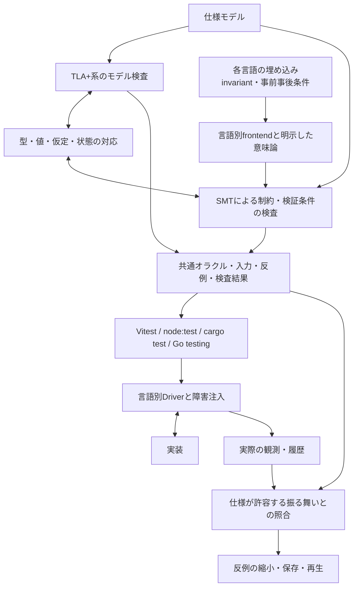

# idealisで実現したい開発

仕様を書き、モデルの性質を検査し、その仕様に実装を従わせる。idealisは、この流れを普段のテストランナーとCIへ組み込むためのポータブルなツールキットを目指す。最初の対象言語はTypeScript、Rust、Go。

このページは設計の方向と今後の計画を記す。現在のAPIと対応範囲は[README](../README.md#現在の実装とこれから)、[モデルと実装の接続](using-models.md)、[backend契約](backend-contract.md)を参照。

業務の語彙と規則を形式的な性質へつなぐ言語を Idealis と呼び、ソースの拡張子を `.ideal` とする。言語コアと再利用可能な検査器の境界は [Idealis 言語の設計](language-architecture.md) にまとめる。

## SMTとTLA+を中心にする

設計の出発点は、値や制約の検査ではZ3/SMT、状態遷移や実行履歴の検査ではTLA+が繰り返し必要になる、という実感にある。この二つを相互運用できる基盤として用意し、形式化の結果をテストへ渡せるようにする。

| 軸                 | 主に表すもの                                  | テストへ渡したいもの                           |
| ------------------ | --------------------------------------------- | ---------------------------------------------- |
| Z3 / SMT           | 値の制約、事前・事後条件、invariantの検証条件 | 条件を満たす入力、違反する代入、求解できた範囲 |
| TLA+系のモデル検査 | 状態、操作、並行実行、障害、時間的な性質      | 許容する操作・観測、到達状態、違反する実行履歴 |

これはidealisの設計上の軸であり、あらゆる形式手法がこの二つへ帰着するという主張ではない。TLA+の探索IRとSMTの論理式は異なる表現である。型・値・仮定・検証結果の境界をそろえ、必要な部分を明示的に変換する。

ブラウザ、native、CIで同じ仕様・保存case・反例を使えるライブラリを目指す。必要なbackendとadapterだけを組み込み、テストランナーと検査エンジンの実行時依存を分ける。現在も有限モデルの照合やRust/Wasmの対応サブセットは外部solverなしで動く。Z3を使う経路は別adapterとして持ち、backendごとの対応理論や実行環境を明記する。

以下は目標の構成。現在はTLA+探索とSMT問い合わせが別経路で動き、相互変換と埋め込み注釈のfrontendは未実装。

## 中心に置くのはモデルと実装の照合

[Quint Connect](https://github.com/quint-co/quint-connect)は、Quintから生成したトレースをDriver経由でRust実装へ再生し、実装の状態を仕様に対応付けて検査する。この接続方法を参考に、idealisでは同じモデル・操作列・期待観測を複数言語の実装へ使いたい。

ITF を読み、同じトレースを Rust・TypeScript・Go の実装で再生する入口を [idealis connect の API 案](connect.md) にまとめた。

目標とする開発の流れは次のとおり。

1. 状態・操作・invariant・環境仮定を仕様に書く。モデル自体の矛盾や性質違反を検査する。
2. モデルから操作列と許容する観測を作る。必要ならSMTで入力や境界値を求める。
3. 各言語のDriverが実装を初期化し、操作を呼び、仕様と比較できる観測を返す。
4. 障害・再試行・実行順を変えながら、実装の観測履歴が仕様の許す振る舞いに含まれるか調べる。
5. 逸脱した操作列と選択を縮小・保存し、実装や仕様を修正した後もCIで再生する。

例えば、同じrequest IDの再試行は一度だけ反映される、という仕様を書く。モデルと実装へ「要求を適用 → crash → restart → 同じ要求を再試行」を渡し、重複適用がないか照合する。Driverは実装の状態を仕様上の値へ写すが、期待値を実装の結果から作ってはいけない。[3言語の共通オラクル評価](shared-oracle.md)は、この使い方の現在の試作に当たる。

非決定的な仕様では、一つの結果との完全一致に限定しない。履歴に整合する候補を残し、仕様が許容する観測集合との照合を行う。モデルの状態と実装の内部状態を同一視せず、操作と観測の対応をDriverで明示する。

[Quintの公式MBT資料](https://quint.sh/docs/model-based-testing)が区別するように、モデルからテストを生成する経路と、実装で取得した履歴をモデルへ照合する経路の両方を扱いたい。Quint言語・Quint Connect API・ITFの互換性や直接接続は、現在の実装済み機能には数えない。

[Quint生成TLA+の実行](quint-generated.md)は、Rust frontendの限定したfragmentで確認している。生成物の実行と、Quint ConnectのDriverやITFへ直接接続する機能は別の範囲として扱う。

## 埋め込みinvariantを言語別frontendからつなぐ

[Why3](https://why3.org/)はWhyMLなどの表現から検証条件を作り、外部proverへ渡す。[WhyMLの注釈](https://why3.org/doc/whyml.html)には事前・事後条件、assertion、loop invariantがある。参考にするのは、言語ごとの表現を検証条件へ変換し、検査側を再利用する構成。

idealisでも、実装の近くに書いたinvariantや事前・事後条件を、言語別frontendから共通の検証条件へつなぎたい。TS・Rust・Goで注釈の構文を同じにする必要はない。ソース位置、対象となる状態・入力、仮定、検査する式を共通の境界へ渡す方針で、注釈構文や公開APIは未確定。

| 検査                       | 対象                           | 現在地                                                |
| -------------------------- | ------------------------------ | ----------------------------------------------------- |
| 実行中の観測に対する検査   | テストで実際に通った入力と状態 | Driverの観測とモデルを照合できる                      |
| モデルのinvariant検査      | 指定した有限モデルの到達状態   | `Model.invariants`やTLA+系checkerで対応する範囲がある |
| 埋め込み注釈からの静的検査 | ソースの意味を表す検証条件     | 注釈の抽出・VC生成・各言語の意味付けは今後の計画      |

静的な検証条件（VC）は、例えば「初期条件からinvariantが成立する」「invariantと遷移から次状態でも成立する」「終了条件とinvariantから事後条件が成立する」と分ける。loopや関数の実装を翻訳するには、その言語の意味をfrontendが表す必要がある。式をSMTへ渡すだけで任意プログラムの検証が完成するわけではない。

SMTが返す代入は、まず検証条件に対する反例。実装から到達できる履歴とは限らないため、操作列へ対応付けられる場合にDriverで再現する。[backend契約](backend-contract.md)でも、個別obligationの反例と、元モデルからのbehaviorを区別している。

## TS・Rust・Goの接続境界

共通コアはテストランナーや各言語のI/Oを所有しない。モデル・制約・値・観測・反例の契約と、生成・照合・縮小・再生を担当する。テストランナーはcaseを実行し、Driverは実装への操作、状態の抽象化、時計・乱数・通信・永続化の制御を担当する。

| 初期対象   | テストへの接続                | 現在利用できる主な経路                                   |
| ---------- | ----------------------------- | -------------------------------------------------------- |
| TypeScript | Vitest、`node:test`、ブラウザ | Model/Driver、Rust/Wasmコア、PBT・差分・再生、Z3 adapter |
| Rust       | `cargo test`                  | nativeの共通コア、独立crate、PBT・差分・保存caseの再生   |
| Go         | `testing`                     | CGOなしのWasm adapter、有限モデル・実装・履歴の照合      |

言語をまたいで再利用するものは、仕様、有限モデル、問い合わせ、操作列、観測、障害やscheduleの選択記録、反例。実装を呼ぶDriverと注釈を読むfrontendは言語ごとに用意する。3言語で全APIがそろっているという意味ではなく、まず既存の共通オラクル経路を基準に接続を増やす。

## 相互運用で固定する意味

TLA+系checkerとSMT backendをつなぐ際は、以下を変換の契約に含める。

- 整数の幅・範囲・overflow、集合やsequenceの表現、値の等価性。
- 初期状態、環境仮定、操作と観測の対応、実装からモデルへの抽象化。
- 有限化した領域、深さ・状態数・work予算、backendの対応範囲と版。
- 反例が論理式の代入か実行履歴か、実装で再現できたか。

例えば現在のrtlc bridgeは`tlc-1.7.4-int32`、SMTのIntは任意精度整数を使う。両者を同じ数値型と見なして結果を混ぜない。モデル検査の完了、有限範囲での反例なし、実行した履歴の一致、個別VCの成立を分けて保存し、unknown・未対応・予算切れ・空の初期集合を合格へ変えない。

## 進める順序と評価基準

1. 既存の共通契約に、TLA+状態とSMTの値・制約の対応を明記し、限定したモデルで往復を検査する。
2. 同じ仕様と保存caseから、TS・Rust・GoのDriverを動かす使い方を整える。正常実装と故障実装の対照を残す。
3. 埋め込みinvariantのfrontendを試作し、実行時の検査と静的な検証条件を別々に接続する。
4. 対応する注釈・言語機能・理論を増やし、counterexampleをソース位置と再現可能なcaseへ戻す。

採用判断は、実装で再現した仕様とのずれ、反例の理解と再生、正常版の対照、CIでの実行・診断費用で行う。新しいbackendや理論の追加そのものを成果の指標にしない。条件と保証範囲を[evals](../evals/README.md)へ記録しながら、試作から使える経路を選ぶ。

## TODO — Java 不要 CLI の互換範囲

connect の設計を先行し、次の互換対応は後続タスクで扱う。現状の範囲は [idealis-cli の対応表](../crates/idealis-cli/SUPPORT.md) を参照。

- [ ] TLC の simulation（`-simulate` と seed）、深さ優先の反復深化（`-dfid`）に対応する。
- [ ] TLC の `-tool` 出力、checkpoint の作成と `-recover` による再開を対応表に分けて追加する。
- [ ] SANY の名前解決・level 検査の未対応例を fixture 化する。各項目は公式 v1.7.4 と同じ入力で診断・終了コード・必要な出力を比較してから対応済みにする。
