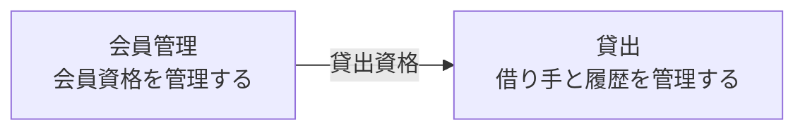

# 貸出と会員管理をつなぐ

会員管理は、貸出を許可されている会員を管理します。図書館はその情報を読んで貸出を判断します。資格を停止された会員も、自分が借りている本は返せます。

## 業務ルールからモデルを組み立てる

「有効な会員だけが借りられる」の「有効」が、誰のどの時点の判断かを決めます。この例では会員管理の正本を使い、時点を貸出の直前にしました。会員管理と貸出で同じ会員を参照するため、`Member` は共有する型にします。[用語辞書](dictionary.ideal) · [業務ルール](spec.pkl) · [共有する型](types.ideal)



| 決めること               | この例での決め方                                                                       |
| ------------------------ | -------------------------------------------------------------------------------------- |
| 誰が情報を持つか         | 会員管理が貸出資格を持ち、貸出が借り手と履歴を持つ。                                   |
| 何を操作にするか         | 資格停止、貸出、返却。通知経由では停止通知の反映も独立の操作にする。                   |
| 操作を許す条件は何か     | 貸出は資格が有効で借り手が空のとき。返却は呼び出しで指定した会員が現在の借り手のとき。 |
| どの時点を検査するか     | 貸出の直前の資格は `before`、返却の前後で履歴を保つ規則は `unchanged` で書く。         |
| どんな操作順を確かめるか | 停止してから貸出、停止して通知が届いてから貸出、貸出してから停止・返却。               |

「資格停止後にも自分の本を返せる」は、返却が実際に起きる経路を探します。「返却しても履歴を変えない」は、返却の前後を比較します。同じ返却でも、問いに応じて到達経路と遷移の性質を使い分けます。

## 辞書を参照して形式化する

先に `dictionary.ideal` に「有効な会員」と「貸出側が有効と把握している会員」を別々に登録します。両プロジェクトはマニフェストの `dictionary` で同じ辞書ソースを読みます。モデルでは用語 ID を状態に結び付けます。

```ideal
var activeMembers: set Member
term "active-member" for activeMembers
```

通知版では `known-active-member` を `knownActiveMembers` に結び付けます。Pkl の業務ルールは同じ辞書から生成した `dictionary.spec.json` を読みます。辞書を変更したら `just spec-write` で再生成します。辞書の ID や状態名が解決できない場合と、状態として登録した用語を操作に割り当てた場合は、モデルを読み込む時点でエラーになります。

```sh
crates/idealis-check/target/debug/idealis-check generate \
  examples/model-patterns/library-membership/notification.project.json dictionary
```

この出力で「貸出履歴」は `library_everBorrowed` を指します。結び付けは接続後の名前で表示されるので、部品の `@everBorrowed` がどの状態になったかも分かります。

## 接続を変える

二つの部品は同じ `eligible: set Member` ポートを使います。会員管理のポートは書き込み用、貸出のポートは読み取り用です。`@eligible` は接続先が決める名前で、`@borrower` と `@everBorrowed` は貸出部品の状態です。[会員管理](membership.ideal) · [貸出](library.ideal)

| 接続                                  | 会員管理が書く状態 | 貸出が読む状態       |
| ------------------------------------- | ------------------ | -------------------- |
| [直接参照](direct.project.json)       | `activeMembers`    | `activeMembers`      |
| [通知経由](notification.project.json) | `activeMembers`    | `knownActiveMembers` |

通知経由では、`membership_suspend` で資格の正本が変わり、別の操作 `deliverSuspension` で貸出側の情報が追いつきます。通知は「正本から消え、貸出側にまだ残っている会員」で表します。この例では資格の停止だけを扱います。[通知のモデル](delivery.ideal)

## 同じ業務ルールを二つの接続で検査する

リポジトリのルートで実行します。

```sh
cargo build --locked --manifest-path crates/idealis-check/Cargo.toml --bin idealis-check
checker=crates/idealis-check/target/debug/idealis-check
dir=examples/model-patterns/library-membership
direct="$dir/direct.project.json"
notification="$dir/notification.project.json"

"$checker" "$direct" --checker reference --question BorrowRequiresActive --expect holds
"$checker" witness "$notification" BorrowRequiresActive
```

`BorrowRequiresActive` は、貸出の直前に資格の正本で会員が有効だったことを求めます。直接参照では成立します。通知経由では `Aki を停止 → Aki が Copy0 を借りる` の2手が反例です。貸出時点の正本に Aki はおらず、貸出側にはまだ Aki が残っています。

規則 ID からも同じ検査を実行できます。Pkl の仕様では、どちらの接続にも業務ルールの成立を求めています。

```sh
spec_json=$(mktemp)
pkl eval -f json "$dir/spec.pkl" > "$spec_json"
"$checker" traceability "$spec_json" --root "$dir" --rule LIBRARY-RETURN-KEEPS-RECORD
status=0
"$checker" traceability "$spec_json" --root "$dir" --rule LIBRARY-ACTIVE-AT-BORROW || status=$?
rm "$spec_json"
test "$status" -eq 1
```

返却履歴の規則は両接続で `matched` です。貸出資格の規則は直接参照が `matched`、通知経由が `mismatch` となり、2つ目の照合コマンドは終了コード1を返します。反例を許容するなら、業務ルールを「貸出側で確認できた資格」に変える判断が要ります。停止後の新規貸出を即時に止めるなら、このモデルでは直接参照が条件を満たします。

次の二つの問いで、停止通知が届く経路があることと、停止通知を反映した貸出側では Ren が借りられないことを確認します。

```sh
"$checker" witness-step "$notification" deliverSuspension 'm = Ren'
"$checker" witness-step "$notification" library_borrow \
  'm = Ren and Ren not in before(knownActiveMembers)'
```

最初の結果は `reachable` で、Ren の資格停止と通知の2手が返ります。次は `unreachable` です。

## 資格停止後も返却できる

```sh
"$checker" witness-step "$direct" library_giveBack \
  'm = Ren and Ren not in before(activeMembers)'
```

`Ren が借りる → Ren を停止 → Ren が返す` の3手が返ります。最後は借り手が空で、貸出履歴には `Copy0` が残ります。

貸出側の Go インターフェースを生成するには、`"$checker" generate "$notification" go --public` を使います。公開操作は貸出と返却です。資格停止と通知は接続したモデルの探索に含まれます。

## 資格の参照先を変えたら、確認箇所を逆引きする

```sh
spec_json=$(mktemp)
pkl eval -f json "$dir/spec.pkl" > "$spec_json"
"$checker" impact "$notification" knownActiveMembers --spec "$spec_json" --root "$dir"
rm "$spec_json"
```

`knownActiveMembers` は `deliverSuspension` が読み書きし、`library_borrow` が読みます。検査の `BorrowRequiresKnownEligibility` はその状態を直接参照し、正本を読む `BorrowRequiresActive` は `library_borrow` を経由して一覧に出ます。後者から業務規則 ID `LIBRARY-ACTIVE-AT-BORROW` まで戻れます。

実装照合では、テスト側のアダプタが生成された操作を実際の貸出サービスや通知処理に渡し、結果の状態を読み取ります。たとえば通知経由版なら、会員管理と貸出側で見えている資格を別々に観測します。実装とテストを仕様の `groundings` に登録した場合は、`impact` がその参照をモデル単位で表示します。[HTTP 実装との照合例](../checkout/README.md#検査した操作を実装で再生する)
